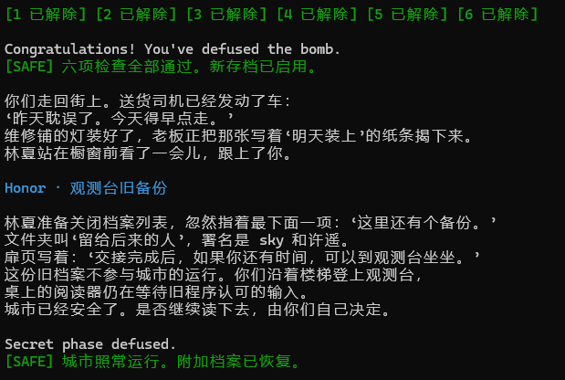

# Lab2 BombLab 实验报告

## 实验环境

- 系统：Ubuntu 26.04 (WSL2, x86_64)
- 工具链：GCC、GNU Make、Python 3.14、binutils (objdump)
- 个人炸弹：通过 config.txt 填写学号后 `make bomb` 领取（package f6cb9be22f10927ec7f8614f）

## 总体思路

每个正式关卡的结构一致：`phase_N` 先校验输入行格式（`valid_u32_fields`），再用 `sscanf` 解析出若干 `%u` 整数，与由 challenge 经若干计算得到的期望值逐项比较。因此解法是：用 `objdump` 离线反汇编读出「challenge → 期望值」的计算关系，在 `defuser.c` 中用 C 还原（全部按 32 位无符号运算，加法/乘法自然回绕，对应汇编中写 `eax` 的截断语义），再对多个 seed 运行 `./defuser | ./bomb` 验证。

## 第 1 关（函数调用、参数传递、返回值）

关键汇编（phase_01 → p1_compute → p1_step0/1/2）：

```asm
mov    %rsi,%r12          ; r12 = challenge
...
mov    %r12,%rdi
call   p1_compute         ; eax = p1_compute(challenge)
cmp    %eax,-0x14(%rbp)   ; 与输入的唯一整数比较
```

`p1_compute` 把 challenge 拆成低 32 位 lo、高 32 位 hi 和右移 16 位取低 32 位 mid，依次调用三个小函数：

```asm
p1_step1: lea 0x76ac(%rsi),%eax ; xor %edi,%eax   ; eax = (mid + 0x76ac) ^ hi
p1_step0: lea (%rdi,%rsi,8),%eax ; xor $0x2553,%eax ; eax = (lo + 8*hi) ^ 0x2553
p1_step2: xor $0xd101,%esi ; lea (%rsi,%rdi,8),%eax ; eax = (s1 ^ 0xd101) + 8*s0
```

恢复的计算关系（均按 uint32_t）：

```
s1 = (mid + 0x76ac) ^ hi
s0 = (lo + 8*hi) ^ 0x2553
答案 = (s1 ^ 0xd101) + 8*s0
```

## 第 2 关（数组、循环、递推关系）

关键汇编：`phase_02` 解析 6 个整数后，先检查第 1 个：

```asm
shr    $0xe,%rax          ; rax = challenge >> 14
movzbl %al,%eax           ; (challenge >> 14) & 0xff
lea    (%rax,%rax,2),%eax ; * 3
cmp    %eax,%edx          ; field[0] == 该值
```

随后是一个 5 次循环（`shr %cl,%rax` 中 cl 从 3 递增到 7，`add $0xd,%edi` 使加数每轮加 13）：

```asm
add    %edx,%edx          ; field[i] * 2
shr    %cl,%rax           ; challenge >> (i+3)
and    $0x3f,%eax         ; & 0x3f
xor    %edx,%eax          ; ^ (field[i]*2)
add    %edi,%eax          ; + 13*(i+1)
cmp    %eax,%edx          ; field[i+1] == 该值
```

恢复的递推关系（i = 0..4）：

```
field[0] = 3 * ((challenge >> 14) & 0xff)
field[i+1] = (2*field[i] ^ ((challenge >> (i+3)) & 0x3f)) + 13*(i+1)
```

## 第 3 关（switch 分支与跳转表）

关键汇编：

```asm
mov    %r12d,%edi
and    $0x7,%edi          ; 第 1 个数 = challenge & 7（用作 switch 下标）
...
jmp    *0x405820(,%rax,8) ; 通过跳转表间接跳转
```

`p3_dispatch(idx, x)` 中 `jmp *0x405820(,%rax,8)` 是典型的 switch 跳转表：`.rodata` 中 8 个 8 字节条目分别指向 8 个 case 存根。从表内容和各 case 函数恢复出下标到 case 的映射：

```
x = ((challenge >> 32) ^ (challenge >> 3)) 的低 32 位
idx 0→5x+0x3ec92  1→(4x)^0x4d2c  2→(x^0xc11d)+(x>>1)  3→(2x)^0x62e9
    4→5x+0xeede    5→(x^0xa38)+(x>>2)  6→3x+0xb6f1    7→5x+0x4d166
答案 = (第 1 个数, dispatch 结果)
```

## 第 4 关（递归调用与返回过程）

关键汇编：`phase_04` 用 4 个参数调用 `p4_walk(target, 0, 0x7f, key)`，其中 target = challenge & 0x7f，key = (challenge >> 32) ^ (challenge >> 7)（取低 32 位）。`p4_walk` 是一个二分查找结构的递归：

```asm
mov %edx,%edi ; sub %esi,%edi ; shr $1,%edi ; add %esi,%edi   ; mid = lo + (hi-lo)/2
cmp %eax,%edi ; je  base                                      ; mid == target 时返回 (mid+0xdf)^key
...
cmp %edi,%eax ; jb  left                                      ; target < mid 走左支
call p4_walk                                                  ; 递归，更新 lo/hi
lea (%rax,%rax,4),%eax ; xor %ebx,%eax ; xor $0xb/%0x3,%eax   ; r*5 ^ (mid+key) ^ 常数
```

左支返回时异或 0x3、右支异或 0xb，基底返回 `(mid + 0xdf) ^ key`。在 C 中用完全相同的递归结构还原即可。

## 第 5 关（结构体布局、指针、链表遍历）

关键汇编：`phase_05` 校验两个整数，分别等于 `p5_traverse` 的返回值 eax（累加值）和通过指针写出的 `*r8`（末节点字段）。`p5_traverse`：

```asm
and $0x7,%eax            ; 下标 = challenge & 7
mov 0x405b60(,%rax,8),%rdx ; head = p5_heads[idx]（.rodata 中的指针数组）
...
mov (%rdx),%rdx          ; node = node->next（节点偏移 0）
mov 0x8(%rdx),%esi       ; node->f1（偏移 8）
add 0xc(%rdx),%eax       ; acc += node->f2（偏移 0xc）
```

从 `.rodata` 中 dump 出 `p5_heads`（8 个入口指针）和 12 个 16 字节节点（next/f1/f2），在 C 里重建了链表。步数 n = (challenge >> 3) & 3（0 到 3 步），累加规则：

```
acc = 3 * (((challenge >> 32) ^ (challenge >> 6)) ^ 0x8e47) + head->f2,  acc ^= head->f1
每步：node = node->next;  acc = 3*acc + node->f2;  acc ^= node->f1
答案 = (acc, 末节点 f1)
```

## 第 6 关（函数指针表与间接调用）

关键汇编：`p6_dispatch` 中两次通过同一张函数指针表间接调用：

```asm
mov %rdi,%rbx
shr $0x6,%rdi           ; challenge >> 6
...xor %eax,%edi         ; ^ (challenge >> 32)
call *0x405e00(,%rax,8)  ; ops[challenge & 7](edi)
xor $0x4c6,%eax
mov %eax,%edi
call *0x405e00(%rbx)     ; ops[(challenge & 0x38)/8](edi)
add $0x1a57,%eax
```

表 `p6_ops` 共 8 项，对应 6 个 op 函数（全部 32 位运算）：

```
op_0(x) = (x ^ (x>>2)) + 0xd367      op_1(x) = ((x<<5) + 0x67f6) ^ (5x)
op_2(x) = ror2_左移2(x) ^ 0x19de     op_3(x) = 循环右移1
op_4(x) = (x + 0xd2ea) ^ (x>>2)      op_5(x) = (x ^ 0x600e) + 4x
答案 = ops[(challenge>>3)&7]( ops[challenge&7](x) ^ 0x4c6 ) + 0x1a57,   x = ((challenge>>6)^(challenge>>32)) 低 32 位
```

## Honor（secret_gate / secret_copy / secret_phase）

`secret_gate(line, challenge, context)` 先把输入行复制到栈上缓冲区，检查偏移 32 处的 4 字节是否为 "OPEN"（`cmpl $0x4e45504f,-0xb0(%rbp)`，缓冲区基址为 rbp-0xd0，故偏移为 0x20），再把缓冲区偏移 36 处（`lea -0xac(%rbp)`）交给 `secret_phase` 解析 3 个整数。同时 `strlen(line)-0x24` 必须 ≤ 0x7f，即行长 ∈ [36, 163]——这解释了第七行的结构：前 32 字节任意、随后 "OPEN"、再跟 3 个整数。

（调试中第一次实现的输出行只有 28 字符，长度检查不通过而引爆；重新核对偏移后发现 0x4e45504f 的检查位置在 +32 而非行首，遂修正为 32 字节前缀 + "OPEN" + 3 个数。）

`secret_phase` 恢复的计算关系：

```
A = (challenge>>32) ^ (challenge 低 32 位),  B = (context>>32) ^ (context 低 32 位),  c = context & 3
f1 = c
f2 = (ror(A^B,3) ^ 0x1e46) ^ ( (c*0x968) ^ ((context>>16) 低 32 位) )
f3 = f2 ^ ( B + c + 0x172e + (A>>3) )
第七行 = [32 字节前缀] + "OPEN " + f1 + " " + f2 + " " + f3
```

## 验证记录

公开测试（python3 public_test.py）：正式六关 Public tests: 60/60，Honor Secret public tests: 10/10。

公开列表之外的 seed 验证（每个 seed 六关 + Honor 全部通过，输出 "Secret phase defused."）：

| seed | 结果 |
|------|------|
| 2 | 通过 |
| 3 | 通过 |
| 1000 | 通过 |
| 123456 | 通过 |
| 7777777 | 通过 |
| 20261030 | 通过 |

运行结果截图：



## 工具使用说明

本实验在课程允许范围内使用了 AI 工具（Claude Code）辅助：逐关反汇编的阅读与指令语义解释、计算关系的整理核对、C 解法的编写与调试。所有恢复出的公式都经过手算核对与多个 seed 的实机验证；本人理解了每一关从汇编到 C 的完整推理过程，报告中各关的分析均为本人整理。

参考资料：CS:APP 第 3 章、《Pro Git》、课程 BombLab 实验文档、x86-64 调用约定与指令集手册（objdump 反汇编查看）。
